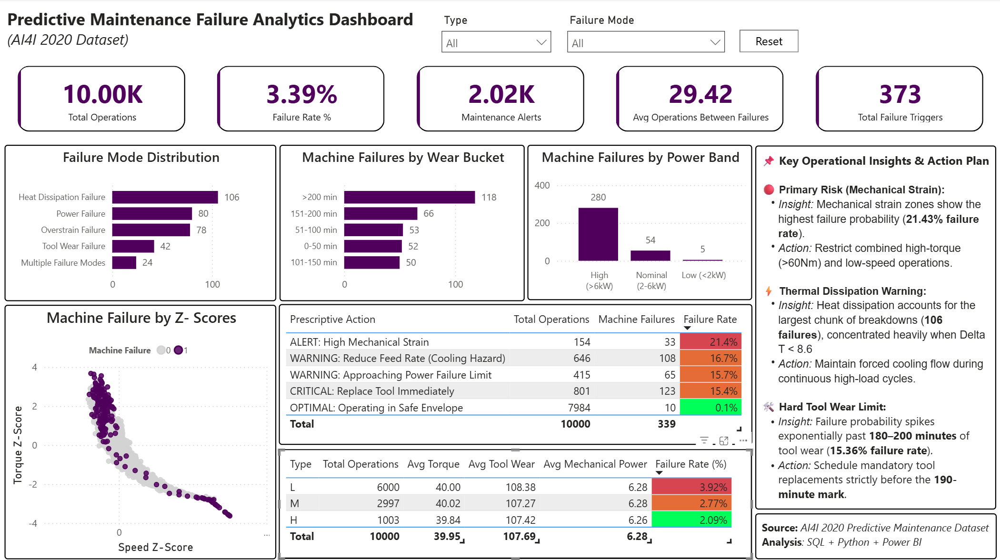

# ⚙️ Predictive Maintenance Failure Analytics Dashboard




## 📌 Project Overview

This project analyzes industrial machine sensor data from the **AI4I 2020 Predictive Maintenance Dataset** to identify operational risks, understand machine failure patterns, and recommend preventive maintenance actions before unexpected breakdowns occur.

Unlike a traditional monitoring dashboard that focuses only on reporting historical events, this solution combines **descriptive, diagnostic, and prescriptive analytics** to support maintenance engineers in making data-driven decisions.

The solution integrates **SQL, Python, Power BI, and DAX** to perform feature engineering, statistical analysis, KPI development, and interactive visualization.

---

# 🎯 Business Problem

Unexpected machine failures result in:

* Unplanned production downtime
* Increased maintenance costs
* Reduced equipment utilization
* Lower manufacturing efficiency

The objective of this project is to transform raw machine telemetry into actionable maintenance intelligence by answering questions such as:

* Which operating conditions increase failure probability?
* How frequently do machines fail?
* Which failures require immediate attention?
* Which operational conditions should be avoided?
* What preventive actions should maintenance teams take?

---

# 📊 Dataset Information

**Dataset:** AI4I 2020 Predictive Maintenance Dataset

| Attribute          | Details                                   |
| ------------------ | ----------------------------------------- |
| Records            | 10,000 Machine Operations                 |
| Features           | 14                                        |
| Failure Indicators | 6                                         |
| Source             | UCI / AI4I Predictive Maintenance Dataset |

Variables include:

* Air Temperature
* Process Temperature
* Rotational Speed
* Torque
* Tool Wear
* Machine Type
* Failure Modes

---

# 🛠 Tech Stack

| Technology | Purpose                                                |
| ---------- | ------------------------------------------------------ |
| SQL        | Data Cleaning, Feature Engineering & Business Analysis |
| Python     | Data Preprocessing                                     |
| Power BI   | Interactive Dashboard                                  |
| DAX        | KPIs & Advanced Measures                               |

---

# 🔄 Project Workflow

```text
Raw Dataset

↓

Python
(Data Cleaning)

↓

SQL
(Feature Engineering)

↓

Power BI

↓

DAX

↓

Interactive Dashboard

↓

Business Insights & Recommendations
```

---

# 📈 Dashboard KPIs

The dashboard tracks key operational metrics:

| KPI                                        | Business Purpose                      |
| ------------------------------------------ | ------------------------------------- |
| Total Operations                           | Overall machine observations analyzed |
| Failure Rate                               | Overall equipment reliability         |
| Maintenance Alerts                         | Machines requiring attention          |
| Average Operations Between Failures (MTBF) | Reliability indicator                 |
| Failure Trigger Count                      | Total recorded failure mechanisms     |

---

# 🔍 Key Analytical Techniques

This project includes multiple analytical approaches rather than simple reporting.

### ✔ Descriptive Analytics

* Failure Distribution
* Machine Type Analysis
* Failure Trigger Analysis

---

### ✔ Diagnostic Analytics

* Tool Wear Bucket Analysis
* Power Band Analysis
* Mechanical Strain Analysis
* Thermal Risk Assessment

---

### ✔ Statistical Analysis

* Z-Score Based Outlier Detection
* Mechanical Power Calculation
* Speed & Torque Normalization

---

### ✔ Reliability Engineering

* Mean Time Between Failures (MTBF)

---

### ✔ Prescriptive Analytics

Machine operating conditions are categorized into actionable maintenance recommendations:

* Critical
* Warning
* Alert
* Safe Operating Zone

---

# 📊 Key Insights

## 1️⃣ Overall Equipment Reliability

Out of **10,000 recorded operations**, the overall machine failure rate was approximately **3.39%**, indicating that failures are relatively rare but operationally significant.

**Business Impact**

Low-frequency failures are difficult to detect manually, making predictive monitoring valuable for reducing unexpected downtime.

---

## 2️⃣ Equipment Reliability (MTBF)

The calculated **Average Operations Between Failures (MTBF)** is approximately:

> **29.42 Operations**

**Interpretation**

Machines typically complete around **29 successful operating cycles before another failure occurs**, providing a useful benchmark for preventive maintenance scheduling.

---

## 3️⃣ Tool Wear Significantly Increases Failure Risk

Failure probability increases substantially once tool wear exceeds approximately **180–200 minutes**.

**Recommendation**

Schedule preventive tool replacement before reaching excessive wear levels instead of waiting for reactive maintenance.

---

## 4️⃣ High Mechanical Strain is a Major Risk Indicator

Machines operating under high mechanical power and abnormal torque conditions exhibit a higher probability of failure.

**Recommendation**

Monitor mechanical load continuously and avoid prolonged operation under high strain.

---

## 5️⃣ Thermal Conditions Influence Machine Reliability

Reduced heat dissipation combined with elevated operating temperatures contributes to increased failure likelihood.

**Recommendation**

Improve cooling efficiency and investigate thermal anomalies before they evolve into equipment failures.

---

## 6️⃣ Statistical Outlier Detection

Z-score analysis successfully identifies abnormal operating behavior even before actual machine failure occurs.

Rather than relying solely on failure events, maintenance teams can proactively investigate statistically abnormal machines.

---

# 💼 Business Recommendations

Based on the analysis, the following preventive actions are recommended:

### 🔴 Critical

Replace heavily worn tools immediately to avoid catastrophic machine failures.

---

### 🟠 Warning

Reduce feed rate during thermal stress conditions to minimize overheating.

---

### 🟡 Alert

Monitor high torque and low rotational speed combinations as indicators of excessive mechanical strain.

---

### 🟢 Preventive Maintenance

Adopt condition-based maintenance scheduling using MTBF and operational risk indicators instead of fixed maintenance intervals.

---

# 📊 Dashboard Features

* Executive KPI Cards
* Interactive Filters
* Cross-filtering Visuals
* Failure Distribution Analysis
* Tool Wear Risk Analysis
* Mechanical Power Analysis
* Statistical Outlier Detection
* Prescriptive Maintenance Table
* Dynamic Business Insights

---

# 🧠 Skills Demonstrated

### Data Analysis

* Exploratory Data Analysis (EDA)
* Reliability Analysis
* Root Cause Analysis
* Statistical Analysis

### SQL

* CTEs
* Window Functions
* Views
* Aggregations
* Feature Engineering

### Power BI

* Interactive Dashboards
* Drill Filtering
* Conditional Formatting
* KPI Design

### DAX

* Calculated Columns
* Measures
* Time-independent KPIs
* Business Logic Implementation

### Business Intelligence

* Dashboard Storytelling
* Executive Reporting
* Decision Support
* Prescriptive Analytics

---

# 🚀 Future Enhancements

* Predictive Machine Learning Models
* Remaining Useful Life (RUL) Prediction
* IoT Sensor Integration
* Real-Time Dashboard Refresh
* Power BI Service Deployment
* Automated Maintenance Alerts

---

# 👨‍💻 Author

**Shivam Lahoty**

B.Tech Computer and Communication Engineering | Manipal Institute of Technology (MIT)

Aspiring Data Analyst | Business Analyst | BI Analyst

---
